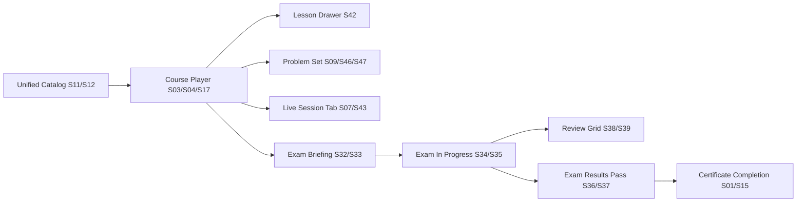
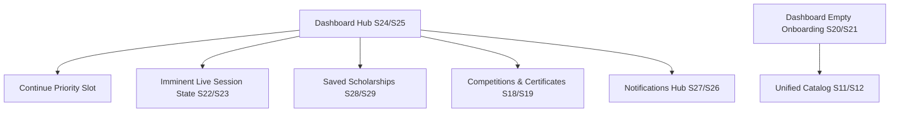
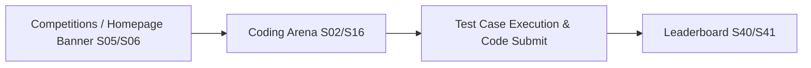

# SCREEN MAP — Khawarizm Academy (أكاديمية خوارزم)

> **Phase 01 — Screen Organization & Project Discovery**  
> Logical hierarchy, flow structure, and viewport mapping of all Figma UI screens and design system specifications.

---

## 1. Top-Level Information Architecture & Screen Tree

The discovered visual screens map into 9 core application areas and 1 design system reference domain:

```
Khawarizm Academy (خوارزم أكاديمية)
├── 1. Homepage (الرئيسية)
│   ├── Desktop  [S05] (Homepage - Desktop.png)
│   └── Mobile   [S06] (Homepage - Mobile.png)
│
├── 2. Unified Catalog (/catalog — دليل المعرفة والمنح)
│   ├── Mixed Feed ("الكل")
│   │   ├── Desktop  [S11] (catalog-all-desktop.png)
│   │   └── Mobile   [S12] (catalog-all-mobile.png)
│   ├── Courses Pre-Filtered ("الدورات")
│   │   ├── Desktop  [S13] (catalog-courses-desktop.png)
│   │   └── Mobile   [S14] (catalog-courses-mobile.png)
│   └── Scholarships Pre-Filtered ("المنح والفرص")
│       └── [Status: Inferred from 02b-unified-catalog.md — no dedicated standalone PNG exported]
│
├── 3. Authentication & Account Access (المصادقة والتسجيل)
│   ├── Desktop
│   │   ├── Default Login (New / Unrecognized User) [S30] (desktop-login.png)
│   │   └── Returning User / "Welcome Back" State    [S31] (desktop-welcome-back.png)
│   └── Mobile
│       └── Default Login [S44] (mobile-login.png)
│
├── 4. Student Personal Dashboard ("لوحتي")
│   ├── Main Hub (Active Enrolled State / Continue Now)
│   │   ├── Desktop  [S24] (dashboard-main-desktop.png)
│   │   └── Mobile   [S25] (dashboard-main.png)
│   ├── Imminent Live Session Priority State
│   │   ├── Desktop  [S22] (dashboard-live-session-desktop.png)
│   │   └── Mobile   [S23] (dashboard-live-session.png)
│   ├── Saved Scholarships Section ("منحي المحفوظة")
│   │   ├── Desktop  [S28] (dashboard-saved-scholarships-desktop.png)
│   │   └── Mobile   [S29] (dashboard-saved-scholarships.png)
│   ├── Competitions & Certificates Section ("إنجازاتي وتحدياتي")
│   │   ├── Desktop  [S18] (dashboard-competitions-certificates-desktop.png)
│   │   └── Mobile   [S19] (dashboard-competitions-certificates.png)
│   ├── Notifications Center (مركز الإشعارات)
│   │   ├── Desktop  [S26] (dashboard-notifications-desktop.png)
│   │   └── Mobile   [S27] (dashboard-notifications.png)
│   └── Onboarding / Empty State (First-Time User)
│       ├── Desktop  [S20] (dashboard-empty-state-desktop.png)
│       └── Mobile   [S21] (dashboard-empty-state.png)
│
├── 5. Course Learning Experience (مشغل المقررات)
│   ├── Video Lesson Player (Tab 1: الدرس)
│   │   ├── Desktop  [S03, S04] (Course path desktop.png, Course player desktop.png)
│   │   └── Mobile   [S17] (course-player-lesson.png)
│   ├── Lesson Syllabus Drawer (منهج الدورة التدريبية)
│   │   ├── Desktop  [Embedded Sidebar in S03, S04, S07, S09]
│   │   └── Mobile   [S42] (lesson-list-drawer.png)
│   ├── Live Session Launchpad (Tab 3: جلسة مباشرة)
│   │   ├── Desktop  [S07] (Live session desktop.png)
│   │   └── Mobile   [S43] (live-session-tab.png)
│   └── Course Completion & Certificate (شهادة التخرج والإنجاز)
│       ├── Desktop  [S01] (Certificate completion desktop.png)
│       └── Mobile   [S15] (certificate-completion.png)
│
├── 6. Practice & Problem Sets (حل المسائل والتمارين)
│   ├── Course Lesson Problem Set (Practice Mode within Course)
│   │   ├── Desktop  [S09] (Problem set desktop.png — Active/Pre-submit)
│   │   ├── Mobile   [S47] (problem-set-quiz.png — Active/Pre-submit)
│   │   └── Mobile   [S46] (problem-set-practice.png — Submitted/Correct Feedback)
│   └── Daily Coding Challenge (Standalone Practice Mode)
│       └── Desktop  [S45] (problem-set-practice-desktop.png — Correct Feedback with Challenge Problem Sidebar)
│
├── 7. Comprehensive Exam System (الاختبار الشامل والتقييمي)
│   ├── Pre-Assessment Briefing Screen
│   │   ├── Desktop  [S32] (exam-briefing-desktop.png)
│   │   └── Mobile   [S33] (exam-briefing.png)
│   ├── Exam Execution (Question View)
│   │   ├── Desktop  [S34] (exam-in-progress-desktop.png)
│   │   └── Mobile   [S35] (exam-in-progress.png)
│   ├── Question Review Grid (Modal / Bottom Sheet)
│   │   ├── Desktop  [S38] (exam-review-grid-desktop.png)
│   │   └── Mobile   [S39] (exam-review-grid.png)
│   └── Exam Results (Pass State)
│       ├── Desktop  [S36] (exam-results-pass-desktop.png)
│       └── Mobile   [S37] (exam-results-pass.png)
│
├── 8. Quizzes & Challenges Hub (الاختبارات والتحديات)
│   ├── Standalone Quiz Hub
│   │   ├── Desktop  [S48] (quiz-hub-desktop.png)
│   │   └── Mobile   [S49] (quiz-hub.png)
│   └── Lesson Quiz Results (Short Assessment Outcome)
│       ├── Desktop  [S10] (Quiz results desktop.png)
│       └── Mobile   [S50] (quiz-results.png)
│
├── 9. Coding Competitions & Leaderboard (المسابقات البرمجية)
│   ├── Coding Competition Arena (Split Code Editor & Test Runner)
│   │   ├── Desktop / Tablet [S02] (Code-Write-Quiz-Desktop.png)
│   │   └── Mobile           [S16] (code-write-quiz-mobile.png)
│   └── Competition Leaderboard (لوحة المتصدرين)
│       ├── Desktop  [S40] (leaderboard-desktop.png)
│       └── Mobile   [S41] (leaderboard-mobile.png)
│
└── 10. Design System Specifications & Canvas Reference Boards (مراجع النظام التصميمي)
    ├── S08: Navbar System — All States.png (Desktop/Mobile Nav Spec)
    ├── S51: صفحات الاختبارات و المسابقات.png (Panoramic Assessment Flow Canvas Strip)
    ├── S52: مرجع النظام التصميمي — الأساسيات.png (Foundations: Color, Type, Spacing, Elev)
    ├── S53: مرجع النظام التصميمي — الأنماط والشاشات.png (Patterns, Templates, RTL, Responsive)
    ├── S54: مرجع النظام التصميمي — المكونات.png (Card variants, Badges, Modals, Banners)
    └── S55: مرجع مكونات التنقل والمصادقة.png (Navigation & Auth Components Spec)
```

---

## 2. Page Groupings & Functional Flows

### Flow A: Course Learning Journey


### Flow B: Logged-in Student Retention Journey (Dashboard)


### Flow C: Competitive Coding & Leaderboard Flow


---

## 3. Unclassified Screens

**Count:** **0**

> [!NOTE]
> All 55 visual files in `Khawarizm Academy Platfrom Design/` have been successfully verified against the Information Architecture and UX specifications outlined in `docs/00-overview.md` through `docs/08-dashboard-ux.md`. No screen requires an "Unclassified" classification.

---

## 4. Documented Missing / Non-Exported UI Screens (Design Gaps)

While the visual inventory covers all exported Figma screens, cross-referencing with the UX documentation (`00-overview.md` through `08-dashboard-ux.md`) reveals several screens described in the product architecture that do not currently have dedicated standalone PNG screenshots in the folder:

1. **Course Landing Page (Desktop & Mobile):**
   * *Described in:* `03-course-system-ux.md` §3 and `06-stitch-prompts.md` Batch 1 Screen 5.
   * *Content:* Course syllabus preview, instructor profile, price/free tag, primary "التسجيل في الدورة" CTA.
   * *Status:* Specified in text, but no visual PNG export exists in the directory.

2. **Scholarship Detail Page (Desktop & Mobile):**
   * *Described in:* `05-scholarships-events-ux.md` §1.3 and `06-stitch-prompts.md` Batch 1 Screen 6.
   * *Content:* External provider badge, eligibility criteria chips, prominent deadline countdown, trust disclaimer box, "التقديم عبر الموقع الرسمي" outbound CTA.
   * *Status:* Specified in text, but no visual PNG export exists.

3. **Standalone Events & Seminars Page (Desktop & Mobile):**
   * *Described in:* `05-scholarships-events-ux.md` §2.2 and `06-stitch-prompts.md` Batch 3 Screen 4.
   * *Content:* Reverse-chronological feed of editorial event announcement cards ("قادمة" and "سابقة").
   * *Status:* Specified in text, visible as a strip on the Homepage, but no dedicated catalog/detail PNG exists.

4. **Instagram Downloads Utility Page:**
   * *Described in:* `05-scholarships-events-ux.md` §4.
   * *Content:* Minimal single-purpose utility input for reel/post URL and video downloader options.
   * *Status:* Specified in text, teaser on homepage, but no standalone page PNG exists.

5. **Pure Scholarships Filter State in Unified Catalog:**
   * *Described in:* `02b-unified-catalog.md` §2.
   * *Status:* Only "الكل" (mixed) and "الدورات" (courses) states were exported (`catalog-all` and `catalog-courses`). The "المنح والفرص" filter segment state is visually represented in the master components board but does not have a dedicated full-page export.

6. **Exam Failure / Attempts Exhausted State:**
   * *Described in:* `04-quiz-exam-system-ux.md` §3.3-3.4.
   * *Status:* Only the Pass state (87% score) was exported (`exam-results-pass`).
